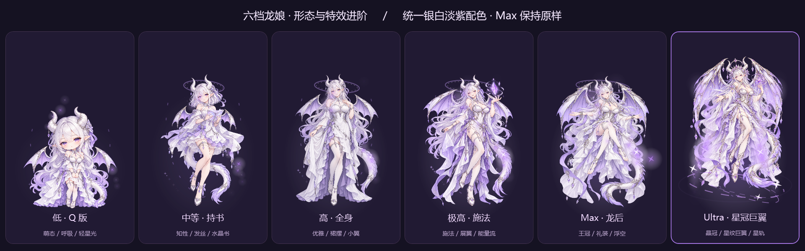

# Codex 龙娘思考动态效果

独立的 Windows 桌面龙娘伴随程序：**只读跟随 Codex 当前本地聊天的思考档位**，展示六种形态及动画。当前版本 **1.4.2**。



v1.4.1 修正 Ultra 偏暗、偏蓝的问题：六档共享银白、淡紫基准照明。现有六张立绘（包括 Max 和 Ultra）、巨翼、点击回应与星光设计均保留。

| 思考档位 | 龙娘形态 | 视觉效果 |
|---|---|---|
| 低 | Q 版 | 眨眼、呼吸、摇尾、歪头、轻星光 |
| 中等 | 持书 | 发丝、短礼裙、水晶书、小翼 |
| 高 | 全身 | 长礼裙、小翼、尾部与能量流 |
| 极高 | 施法 | 悬浮魔晶、展翼与星光 |
| Max | 龙后 | 王冠、浮空坐姿、礼装与披纱 |
| Ultra | 星冠巨翼 | 晶冠、星纹巨翼、星座阵、脚下星轨、密集星芒 |

点击角色有轻跳、歪头、舒展和扩散星芒回应；拖动移动位置。右键可切换自动跟随/备用手动聊天、预览六档、调整大小、锁定位置或进入省电模式。普通模式最高 30 帧；省电模式 20 帧并减少粒子。

## 运行环境

- Windows x64，.NET Framework 4.8（使用 Windows 自带 WPF 和 winsqlite3）。
- 本机 OpenAI.Codex 桌面端；目前该产品的进程名为 ChatGPT.exe。**不支持另一个独立的 ChatGPT 产品。**
- 不需要 API Key、Node.js、Python 或付费图像服务即可运行或构建。

## 构建和预览

在仓库根目录的 PowerShell 执行：

```powershell
.\build.ps1
.\DragonDisplay.exe --preview=six
```

预览滑块只改变龙娘画面，不连接 Codex。源码默认不提交生成的 exe；可自行构建，或从通过的 GitHub Actions 运行中下载打包 artifact。

## 安装与自动启动

```powershell
.\scripts\install.ps1 -InstallDir 'D:\Apps\CodexDragonCompanion'
```

默认安装到上述 D 盘目录，可自行指定其他独立目录。脚本验证复制结果，保留组件自己的 runtime 设置，并注册当前用户的 `CodexDragonCompanion-ReadOnly` 登录计划任务。它独立于 Codex 运行，桌面端退出时等待，重新打开后尝试重连。无需替换桌面端快捷方式或修改其启动参数。

已有安装请传原安装目录；若同名任务指向另一个目录，脚本会拒绝覆盖。源代码目录和安装目录应分开。只想查看效果时使用预览即可，不必安装任务。

停止并移除自启（保留文件和 runtime 数据）：

```powershell
.\scripts\uninstall.ps1 -InstallDir 'D:\Apps\CodexDragonCompanion'
```

## 自动跟随、兼容性与更新

程序只读尾随已有桌面日志中的导航路径，识别当前选中的本地聊天，再用本地 IPC 读取该聊天的思考档位。不会用“最近更新的聊天”猜测目标。通常约 1 秒同步，繁忙、日志写入与连接重试可能增加延迟。

- 不修改模型、思考档位、聊天正文、桌面端程序、数据库、配置或更新器。
- 不注入 DLL，不修改 asar，不注册全局键鼠钩子，不开启调试端口，不安装额外 app-server。
- 数据库仅 READONLY；IPC 写请求受硬白名单禁止；读取有超时和重连退避。
- 桌面端隐藏时停止绘制；文件采用共享读取，不阻止日志轮转、退出或更新。
- 支持已验证的主窗口、本地聊天。多窗口歧义、主页/设置/远程聊天、未知路径或协议会暂停关联，显示等待；可使用备用手动模式。

**内部日志和 IPC 不是稳定公开接口。** 桌面端未来更改格式后，龙娘可能需要适配；不能保证所有未来版本自动兼容。组件采用不识别就暂停的策略，不替换或干预桌面端的正常更新机制。原生思考滑块提交档位后同步，不承诺未提交位置逐点跟随。

## 验证和打包

```powershell
.\scripts\verify.ps1
.\scripts\package.ps1 -SkipBuild
```

验证无需运行 Codex：覆盖只读请求拒绝、当前路由识别、异常输入、六档动态渲染及深浅背景对比。输出位于 `out/`。CI 在 Windows 上执行相同离线验证并上传 ZIP；离线通过不等同于真实桌面端重启或未来版本升级通过。

本机历史实测、兼容边界和未验证项见 [验证说明](docs/verification.md)；实现说明见 [架构](docs/architecture.md)；六档美术取舍见 [形态对比](形态对比说明.md)。

## 素材

六张 PNG 和提示词位于 `assets/`。Ultra v1.4 使用内置 imagegen 重绘，保留原 alpha；Max 与前四档素材未改，原生动态帧逐像素核验一致。详见 [素材来源](docs/assets.md)。仓库未指定开源许可证，使用和再分发请遵循仓库所有者后续授权。

## 新建聊天页面

未发送的新聊天现在识别为独立草稿，显示“新聊天 · 默认档位”，不再显示不支持。临时草稿的档位还不能通过现有只读 IPC 读取，因此此处只展示配置默认值，不冒充未发送草稿中的临时选择；首次发送后导航到正式聊天，自动读取实际档位。未知草稿标识、设置页面等仍暂停关联。
